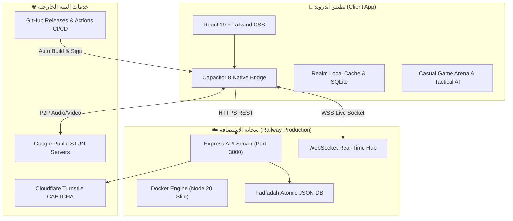

<div align="center">

  

  # 🌟 تطبيق فضفضة · Fadfadah Mobile
  ### مساحتك الآمنة للتعبير والتواصل والألعاب المباشرة بدون قيود
  **The Sovereign, Arabic-First Social Messaging, Casual Gaming & WebRTC Platform**

  <p align="center">
    <a href="https://github.com/jwjj3463-dotcom/Venting/releases/latest"></a>
    <a href="https://github.com/jwjj3463-dotcom/Venting/actions/workflows/release.yml"></a>
    <a href="https://web-production-d1043.up.railway.app"></a>
    <a href="https://github.com/jwjj3463-dotcom/Venting/releases"></a>
  </p>

  <p align="center">
    <a href="https://jwjj3463-dotcom.github.io/Venting/">🌐 الموقع الرسمي</a> •
    <a href="https://github.com/jwjj3463-dotcom/Venting/releases/latest">📥 تنزيل APK المباشر</a> •
    <a href="https://web-production-d1043.up.railway.app">⚡ سيرفر الإنتاج الحي</a> •
    <a href="#-كتالوج-الألعاب-الـ-22">🎲 كتالوج الألعاب</a> •
    <a href="#-المعمارية-التقنية">🏛️ المعمارية التقنية</a>
  </p>

---

</div>

## 📖 نظرة عامة | Overview

**فضفضة (Fadfadah)** هو تطبيق اجتماعي عربي متكامل ومتقدم لهواتف Android، يدمج بين **التواصل الآني المشفر**، و**المكالمات الصوتية والمرئية فائقة الجودة بتقنية WebRTC P2P**، و**منظومة ألعاب تنافسية من 22 لعبة كلاسيكية مدعومة بذكاء اصطناعي تكتيكي (Minimax & Alpha-Beta)**، وغرف دردشة جماعية عامة وخاصة.

يعتمد المشروع على هندسة برمجية حديثة تفصل بين **واجهة المستخدم الأصلية (React 19 + TypeScript + Capacitor 8 + Vite)** وخادم سحابي مستقل عالي التوفر مدعوم بتقنيات الحاويات **(Docker Container on Railway)**.

---

## ✨ أبرز المزايا والقدرات | Core Highlights

<table>
  <tr>
    <td width="50%">
      <h3>🛡️ تسجيل مجهول بدون إفصاح هاتف أو بريد</h3>
      <ul>
        <li>إنشاء حساب فوري باسم مستعار وصورة رمزية مشفرة.</li>
        <li>حماية التسجيل ضد هجمات البوتات عبر <b>Cloudflare Turnstile</b> الذكية.</li>
        <li>رمز استرداد تشفيري (64 خانة) يتيح نقل الحساب بين الأجهزة بأمان كامل.</li>
      </ul>
    </td>
    <td width="50%">
      <h3>🎲 أرينا ألعاب تفاعلية (22 لعبة كلاسيكية)</h3>
      <ul>
        <li>ألعاب استراتيجية: شطرنج، دومينوز، ريفيرسي (أوتيللو)، دامية، نيم، وسفن حربية.</li>
        <li>ألعاب ورق وحظ: جاك أسود، حرب الأوراق، والأرقام السرية.</li>
        <li>محرك ذكاء اصطناعي تكتيكي <b>Alpha-Beta Pruning</b> وتحديات لاعب ضد لاعب مباشرة.</li>
      </ul>
    </td>
  </tr>
  <tr>
    <td width="50%">
      <h3>📞 مكالمات صوت وفيديو مباشرة P2P</h3>
      <ul>
        <li>اتصال ندّ للندّ فائق السرعة عبر بروتوكول <b>WebRTC</b> عالي الأمان.</li>
        <li>تبديل سلس بين الكاميرا الأمامية والخلفية وكتم الصوت وإلغاء الصدى التلقائي.</li>
        <li>خوادم تبادل إشارات سريعة وخوادم STUN لضمان العبور عبر الجدران النارية.</li>
      </ul>
    </td>
    <td width="50%">
      <h3>🏛️ غرف جماعية عامة وخاصة</h3>
      <ul>
        <li>دليل تفاعلي للغرف العربية (سهرة المغرب 🇲🇦، مصر 🇪🇬، الخليج 🇸🇦، الشام 🇸🇾، الألعاب 🎮).</li>
        <li>دعم كامل لغرف خاصة مشفرة بكلمة مرور ورموز دعوة.</li>
        <li>نظام الإشارة الذكية بالاسم <code>@mention</code> وإرسال وسائط وفيديوهات قصيرة.</li>
      </ul>
    </td>
  </tr>
</table>

---

## 🏛️ المعمارية التقنية | Architecture Diagram



---

## 🎲 كتالوج الألعاب الـ 22 | Complete 22 Games Catalog

يحتوي التطبيق على ساحة ألعاب تفاعلية كاملة مع إمكانية اللعب الفردي ضد الذكاء الاصطناعي أو إرسال تحدي مباشر داخل المحادثة:

| # | اللعبة (عربي) | Game (English) | نوع اللعبة | محرك الذكاء الاصطناعي |
|---|---|---|---|---|
| 01 | **إكس-أو** | Tic-Tac-Toe | استراتيجية شبكية | Minimax لا يُهزم |
| 02 | **حجر ورقة مقص** | Rock Paper Scissors | سرعة وتوقع | محلل الاحتمالات السلوكي |
| 03 | **أربعة على التوالي** | Connect Four | استراتيجية عميقة | Minimax بعمق 5 نقلات |
| 04 | **تخمين الرقم** | Guess Number (1–100) | استنتاج وذكاء | Binary Search الأمثل |
| 05 | **الأرقام السرية** | Secret Digits / Bulls & Cows | تفكير منطقي | Knuth 5-Guess Algorithm |
| 06 | **الخنزير بالنرد** | Pig Dice | إدارة المخاطر | استراتيجية العتبة الرياضية (20 نقطة) |
| 07 | **نيم** | Nim | تكتيك الأكوام | المعادلة الثنائية لنظرية بوتون (XOR) |
| 08 | **الذاكرة الصورية** | Memory Match Grid | تركيز وحفظ | مسح مصفوفي بذاكرة متدرجة |
| 09 | **حرب الأوراق** | Card War | كروت كلاسيكية | حاسبة الرتب التلقائية |
| 10 | **أعلى أم أدنى** | Higher or Lower | مراهنة احتمالات | حاسبة التوزيع التكراري للكروت |
| 11 | **بلاك جاك 21** | Blackjack 21 | أوراق كازينو نقية | قواعد الموزع الصارمة (Hit on Soft 17) |
| 12 | **سفن حربية** | Battleship | تكتيك بحري وحرب | خريطة الاحتمالات الحرارية التكتيكية |
| 13 | **الدامية (شيكرز)** | Checkers / Draughts | استراتيجية ألواح | Alpha-Beta Pruning مع تقييم القطع |
| 14 | **أوتيللو (ريفيرسي)** | Reversi / Othello | تطويق وقلب الأقراص | خوارزمية أوزان الزوايا والاستقرار |
| 15 | **الشطرنج المبسط** | Mini Chess | ذكاء استراتيجي | Minimax مع تقييم الملك والمساحات |
| 16 | **لودو كلاسيك** | Ludo Classic | سباق مسارات | محرك أولويات الدخول والأمان |
| 17 | **دومينوز** | Dominoes Block | حجب وربط | محلل الطرفين وحظر القطع |
| 18 | **الكلمات الضائعة** | Word Search Grid | لغة ومعرفة | مولد الشبكات الثنائي |
| 19 | **سودوكو سريعة** | Mini Sudoku (4x4 & 6x6) | ألغاز حسابية | Backtracking Solver فوري |
| 20 | **لغز الأرقام المنزلقة**| Slide 15 Puzzle | ذكاء مكاني | خوارزمية مسافة مانهاتن (A*) |
| 21 | **المتاهة العمياء** | Blind Maze Runner | استكشاف | خوارزمية BFS لأقصر مسار |
| 22 | **رد الفعل السريع** | Reflex Speed Tap | توقيت وردود أفعال | مؤقت عشوائي بدقة المللي ثانية |

---

## 📲 التثبيت والتحميل الرسمي | Downloads & Releases

يمكن للمستخدمين تنزيل التحديثات الرسمية الموقعة مباشرة عبر:
- **الموقع الرسمي للتطبيق:** [jwjj3463-dotcom.github.io/Venting](https://jwjj3463-dotcom.github.io/Venting/)
- **صفحة الإصدارات في المستودع:** [GitHub Releases](https://github.com/jwjj3463-dotcom/Venting/releases/latest)

| الملف | الوصف | آلية التحقق |
|---|---|---|
| 📱 **`app-release.apk`** | ملف التثبيت المباشر لكافة هواتف Android 8.0+ | موقع بمفتاح الشركة الرسمي |
| 📦 **`app-release.aab`** | حزمة Google Play الرسمية الشاملة لكافة معماريات المعالجات | Signed Android App Bundle |
| 🛡️ **`android-release-checksums.txt`** | ملف بصمات التشفير الرسمية (SHA-256) | للتحقق من عدم حدوث أي تلاعب |

---

## 🛠️ أدوات ومكتبات التطوير | Tech Stack

```bash
├── Client: React 19 • TypeScript 5.8 • Vite 8 • Tailwind CSS 4 • Capacitor 8
├── Backend: Node.js 22 • Express 4.21 • WebSocket (ws) • Docker • tsx
├── Cloud: Railway Platform • Google Public STUN • Cloudflare Turnstile
└── Security: Strict SemVer • SHA-256 Checksums • P2P WebRTC Encryption
```

---

<div align="center">
  <sub>تم بناء وتطوير هذا المشروع ليكون المنصة العربية الأكثر أماناً وسلاسة في التواصل والتعبير.</sub><br />
  <sub>جميع الحقوق محفوظة © 2026 فضفضة · Fadfadah</sub>
</div>
